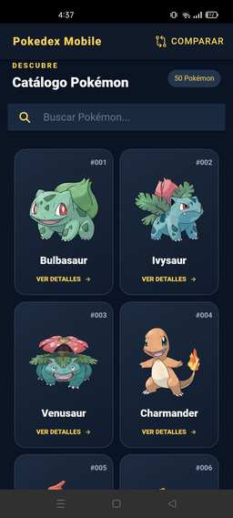
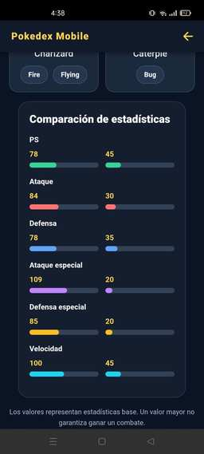
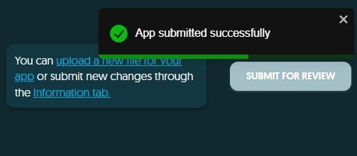
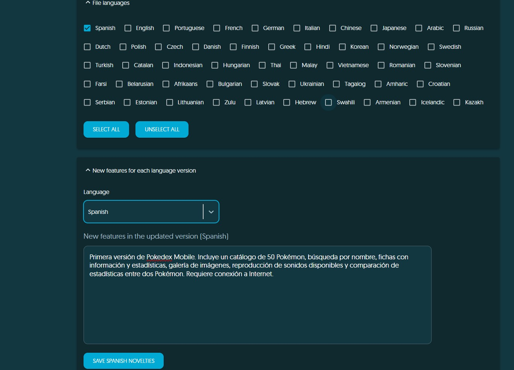
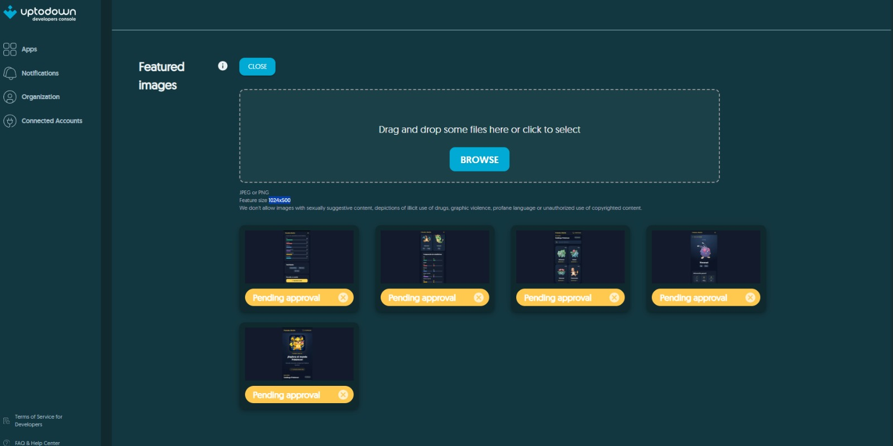

from pathlib import Path

readme = r'''<div align="center">

# Pokedex Mobile

### Explora Pokémon. Consulta sus características. Compara sus estadísticas.

<p>
  <a href="https://github.com/Dilanbkr7/pokeapp/tree/release/pokedex-mobile">
    
  </a>
  
  
  
  
  
</p>

**Aplicación móvil para Android · Versión 1.0.0**

[Repositorio](https://github.com/Dilanbkr7/pokeapp) ·
[Rama de entrega](https://github.com/Dilanbkr7/pokeapp/tree/release/pokedex-mobile)

</div>

---

## Contenido

- [Descripción](#descripción)
- [Funcionalidades](#funcionalidades)
- [Capturas de la aplicación](#capturas-de-la-aplicación)
- [Tecnologías](#tecnologías)
- [Configuración Android](#configuración-android)
- [Instalación y ejecución](#instalación-y-ejecución)
- [Compilación Android](#compilación-android)
- [Generación y verificación del APK firmado](#generación-y-verificación-del-apk-firmado)
- [Pruebas funcionales](#pruebas-funcionales)
- [Distribución en Uptodown](#distribución-en-uptodown)
- [Evidencias de Uptodown](#evidencias-de-uptodown)
- [Fuente de datos](#fuente-de-datos)
- [Estructura del repositorio](#estructura-del-repositorio)
- [Propiedad intelectual](#propiedad-intelectual)
- [Autoría](#autoría)

## Descripción

**Pokedex Mobile** es una aplicación para Android que permite explorar un catálogo de 50 Pokémon, consultar sus fichas individuales y comparar sus estadísticas principales desde una interfaz móvil en español.

La aplicación obtiene información mediante la API pública **PokéAPI**. Sus módulos reúnen el catálogo, la búsqueda por nombre, los detalles de cada Pokémon, sus estadísticas, la galería de imágenes, la reproducción de sonidos disponibles y la comparación entre dos Pokémon.

Se requiere conexión a Internet para consultar los datos y cargar los recursos remotos.

## Funcionalidades

| Módulo | Descripción |
|---|---|
| **Catálogo** | Presenta los primeros 50 Pokémon incluidos en el catálogo de la aplicación. |
| **Búsqueda** | Permite localizar Pokémon por su nombre. |
| **Ficha individual** | Muestra número, nombre, tipos, altura, peso, experiencia base y habilidades. |
| **Estadísticas** | Visualiza PS, ataque, defensa, ataque especial, defensa especial y velocidad mediante indicadores gráficos. |
| **Galería** | Presenta las imágenes disponibles para cada Pokémon. |
| **Sonidos** | Reproduce el audio disponible para el Pokémon seleccionado. |
| **Comparador** | Permite seleccionar dos Pokémon y contrastar sus seis estadísticas base. |
| **Validaciones** | Controla la selección de Pokémon y los estados de carga y consulta. |

## Capturas de la aplicación

Las siguientes capturas corresponden a la versión Android 1.0.0 y están almacenadas en `docs/capturas/release-1.0.0/`.

<table>
  <tr>
    <td align="center" width="50%">
      
      <br><strong>01 · Inicio</strong><br>
      <sub>Identidad visual y acceso a la aplicación.</sub>
    </td>
    <td align="center" width="50%">
      
      <br><strong>02 · Catálogo</strong><br>
      <sub>Listado de Pokémon y búsqueda por nombre.</sub>
    </td>
  </tr>
  <tr>
    <td align="center">
      
      <br><strong>03 · Detalles</strong><br>
      <sub>Información general del Pokémon seleccionado.</sub>
    </td>
    <td align="center">
      
      <br><strong>04 · Estadísticas y sonido</strong><br>
      <sub>Indicadores de capacidades, habilidades y audio.</sub>
    </td>
  </tr>
  <tr>
    <td align="center">
      
      <br><strong>05 · Galería</strong><br>
      <sub>Recursos visuales disponibles para el Pokémon.</sub>
    </td>
    <td align="center">
      
      <br><strong>06 · Selección del comparador</strong><br>
      <sub>Elección de los dos Pokémon que se compararán.</sub>
    </td>
  </tr>
  <tr>
    <td align="center">
      
      <br><strong>07 · Resultados</strong><br>
      <sub>Presentación de los Pokémon seleccionados.</sub>
    </td>
    <td align="center">
      
      <br><strong>08 · Comparación de estadísticas</strong><br>
      <sub>Contraste de los seis atributos principales.</sub>
    </td>
  </tr>
</table>

## Tecnologías

| Tecnología | Versión / configuración | Uso |
|---|---:|---|
| Angular | 18 | Componentes, navegación y lógica de interfaz. |
| Ionic | 8 | Componentes y estructura visual móvil. |
| TypeScript | 5.4.x | Desarrollo tipado. |
| Capacitor | 6 | Integración y empaquetado para Android. |
| RxJS | 7.8.x | Gestión de operaciones asíncronas. |
| PokéAPI | REST API v2 | Fuente de datos y recursos de Pokémon. |
| Java JDK | 17 | Entorno de compilación Android. |
| Android Gradle Plugin | 8.2.1 | Configuración de compilación Android. |
| Gradle Wrapper | 8.2.1 | Automatización de tareas Android. |

## Configuración Android

| Propiedad | Valor |
|---|---|
| Nombre | `Pokedex Mobile` |
| Identificador de paquete | `com.pokedex.mobile` |
| Versión | `1.0.0` |
| Código de versión | `1` |
| SDK mínimo | `22` — Android 5.1 |
| SDK objetivo | `34` — Android 14 |
| Arquitectura del archivo cargado en Uptodown | `universal` |

## Instalación y ejecución

### Requisitos

- Git.
- Node.js y npm compatibles con Angular 18.
- Java JDK 17.
- Android Studio.
- Android SDK y herramientas de compilación correspondientes al proyecto.
- Conexión a Internet para consultar PokéAPI y cargar los recursos remotos.

### Clonar el repositorio

```bash
git clone --branch release/pokedex-mobile --single-branch https://github.com/Dilanbkr7/pokeapp.git
cd pokeapp
npm ci
```

### Ejecutar la aplicación en desarrollo

```bash
npm start
```

### Generar la compilación web

```bash
npm run build
```

## Compilación Android

Desde la raíz del repositorio, ejecuta:

```bash
npm ci
npm run build
npx cap sync android
npx cap open android
```

En Android Studio:

1. Espera a que finalice la sincronización de Gradle.
2. Verifica que Gradle utilice JDK 17 como Gradle JDK.
3. Selecciona un emulador o dispositivo Android conectado.
4. Ejecuta la configuración `app` para instalar y probar la aplicación.

Después de modificar el código web, ejecuta nuevamente `npm run build` y `npx cap sync android` antes de generar o probar la aplicación Android.

## Generación y verificación del APK firmado

Para generar el APK de distribución desde Android Studio:

1. Abre el proyecto Android mediante `npx cap open android`.
2. Selecciona **Build → Generate Signed Bundle / APK**.
3. Selecciona **APK**.
4. Elige el módulo `app`.
5. Selecciona la variante `release`.
6. Firma el archivo con el keystore de distribución correspondiente.
7. Conserva el keystore y su alias en un lugar privado y seguro.

El keystore, las contraseñas y los archivos privados de firma no deben incluirse en el repositorio. Para futuras actualizaciones debe conservarse el mismo certificado de firma utilizado para distribuir la aplicación.

### Verificar la firma

Desde PowerShell, en la carpeta donde se encuentre el APK, ejecuta:

```powershell
$apk = ".\app-release.apk"
& "$env:ANDROID_HOME\build-tools\34.0.0\apksigner.bat" verify --verbose --print-certs $apk
```

### Verificar la alineación y calcular SHA-256

```powershell
& "$env:ANDROID_HOME\build-tools\34.0.0\zipalign.exe" -c -v 4 $apk
Get-FileHash -Algorithm SHA256 -LiteralPath $apk
```

### Instalar el APK en un dispositivo conectado

```powershell
& "$env:ANDROID_HOME\platform-tools\adb.exe" devices -l
& "$env:ANDROID_HOME\platform-tools\adb.exe" install -r $apk
```

La ruta habitual del APK release generado por Gradle es `android/app/build/outputs/apk/release/app-release.apk`.

## Pruebas funcionales

Durante las comprobaciones funcionales de la aplicación en Android se registraron ocho pruebas superadas:

| N.º | Prueba | Verificación | Resultado |
|---:|---|---|---|
| 1 | Inicio | La aplicación abre y carga el catálogo. | Correcto |
| 2 | Búsqueda | Filtra el catálogo por nombre. | Correcto |
| 3 | Detalles | Abre la ficha y muestra sus características. | Correcto |
| 4 | Sonido | Reproduce el audio disponible. | Correcto |
| 5 | Galería | Muestra y permite ampliar las imágenes. | Correcto |
| 6 | Comparador | Compara dos Pokémon y sus estadísticas. | Correcto |
| 7 | Validación | Controla una selección inválida en el comparador. | Correcto |
| 8 | Reapertura | La aplicación vuelve a abrir después de cerrarla. | Correcto |

**Resultado registrado: 8 de 8 pruebas funcionales superadas.**

## Distribución en Uptodown

Pokedex Mobile fue registrada en **Uptodown Developers Console** y la versión 1.0.0 fue enviada correctamente a los editores para revisión.

### Datos del envío

| Campo | Información |
|---|---|
| Aplicación | Pokedex Mobile |
| Versión | `1.0.0` |
| Version Code | `1` |
| Package name | `com.pokedex.mobile` |
| Tamaño del archivo cargado | `11.05 MB` |
| ABI | `universal` |
| Modelo de distribución | Free |
| Compras integradas | No |
| Suscripciones | No |
| Anuncios | No |
| Tipo de licencia configurado en la consola | Proprietary |
| Fecha del envío | 16 de noviembre de 2026 |
| Estado | **Enviado correctamente; pendiente de revisión editorial** |

> **Estado de publicación:** Uptodown confirmó que la aplicación fue enviada correctamente a sus editores. La versión 1.0.0 figura pendiente de revisión. El envío no equivale a aprobación editorial ni a publicación pública.

## Evidencias de Uptodown

Las siguientes capturas documentan la configuración de la ficha, la carga de recursos y el envío de la versión 1.0.0. Los archivos originales se conservan en `docs/capturas/uptodown/`.

<table>
  <tr>
    <td align="center" width="50%">
      
      <br><strong>01 · Envío confirmado</strong><br>
      <sub>Confirmación de que la aplicación fue enviada correctamente.</sub>
    </td>
    <td align="center" width="50%">
      
      <br><strong>02 · Confirmación previa</strong><br>
      <sub>Confirmación mostrada antes de remitir la aplicación a los editores.</sub>
    </td>
  </tr>
  <tr>
    <td align="center">
      
      <br><strong>03 · Versión 1.0.0</strong><br>
      <sub>Información del paquete y estado pendiente de revisión.</sub>
    </td>
    <td align="center">
      
      <br><strong>04 · Idioma y novedades</strong><br>
      <sub>Configuración del idioma español y descripción de novedades.</sub>
    </td>
  </tr>
  <tr>
    <td align="center">
      
      <br><strong>05 · Estado de las capturas</strong><br>
      <sub>Panel de gestión y estado de los recursos gráficos.</sub>
    </td>
    <td align="center">
      
      <br><strong>06 · Imágenes destacadas</strong><br>
      <sub>Sección destinada a los recursos gráficos destacados de la ficha.</sub>
    </td>
  </tr>
  <tr>
    <td align="center">
      
      <br><strong>07 · Galería de capturas</strong><br>
      <sub>Vista de las imágenes incorporadas a la ficha de la aplicación.</sub>
    </td>
    <td align="center">
      
      <br><strong>08 · Carga de capturas</strong><br>
      <sub>Interfaz utilizada para incorporar imágenes a la ficha.</sub>
    </td>
  </tr>
</table>

La aprobación del APK y de los recursos gráficos depende de la revisión editorial de Uptodown. La disponibilidad pública se confirmará únicamente cuando la plataforma apruebe y publique la aplicación.

## Fuente de datos

La aplicación utiliza [PokéAPI](https://pokeapi.co/), una API REST pública.

| Recurso | Endpoint | Propósito |
|---|---|---|
| Catálogo inicial | `https://pokeapi.co/api/v2/pokemon?limit=50&offset=0` | Obtener los nombres y referencias de los primeros 50 Pokémon. |
| Ficha individual | `https://pokeapi.co/api/v2/pokemon/{nombre_o_id}` | Obtener tipos, medidas, estadísticas, habilidades, imágenes y recursos de audio disponibles. |

Las imágenes y los sonidos dependen de los recursos proporcionados por la API y sus enlaces asociados. No se requiere configurar una clave de API en el proyecto.

## Estructura del repositorio

```text
pokeapp/
├── android/                         # Proyecto nativo Android con Capacitor
├── docs/
│   └── capturas/
│       ├── release-1.0.0/            # Capturas de la aplicación Android
│       └── uptodown/                 # Evidencias de envío y revisión
├── src/
│   ├── app/                          # Componentes, páginas y servicios
│   ├── assets/                       # Recursos estáticos
│   ├── environments/                 # Configuración de entornos
│   └── theme/                        # Variables y estilos
├── capacitor.config.ts               # Configuración de Capacitor
├── ionic.config.json                 # Configuración de Ionic
├── angular.json                      # Configuración de Angular
├── package.json                      # Dependencias y scripts
└── README.md                         # Documentación del proyecto
```

## Propiedad intelectual

Pokémon y los nombres, personajes, marcas, diseños, ilustraciones, sprites y sonidos asociados pertenecen a sus respectivos titulares. Pokedex Mobile es un proyecto independiente y no está afiliado, patrocinado ni respaldado por Nintendo, The Pokémon Company, Game Freak o Creatures Inc.

PokéAPI se utiliza como fuente técnica de datos. La disponibilidad de sus recursos no implica autorización para redistribuir marcas o materiales protegidos. La distribución de la aplicación y de sus recursos debe respetar los derechos de sus titulares y las condiciones aplicables.

## Autoría

**Dilan Obando**

- GitHub: [@Dilanbkr7](https://github.com/Dilanbkr7)
- Repositorio: [Dilanbkr7/pokeapp](https://github.com/Dilanbkr7/pokeapp)
- Rama de entrega: [`release/pokedex-mobile`](https://github.com/Dilanbkr7/pokeapp/tree/release/pokedex-mobile)

---

<div align="center">

**Pokedex Mobile · Android · Versión 1.0.0**

<sub>Documentación técnica y evidencias de distribución.</sub>

</div>
'''

out = Path("/mnt/data/README-Pokedex-Mobile.md")
out.write_text(readme, encoding="utf-8", newline="\n")
print(f"Archivo creado: {out.name}")
print(f"Tamaño: {out.stat().st_size:,} bytes")
print(f"Líneas: {len(readme.splitlines()):,}")
