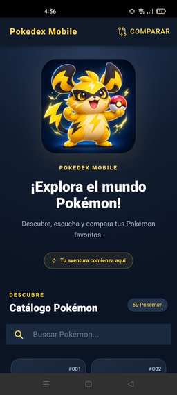
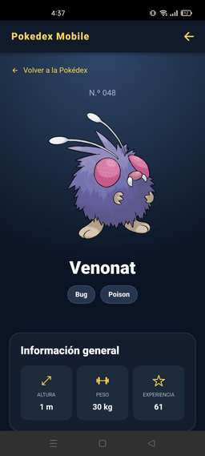
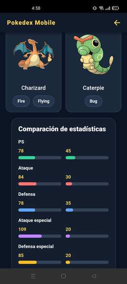
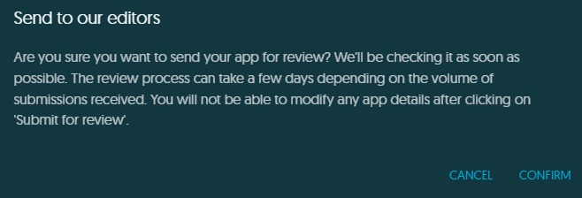
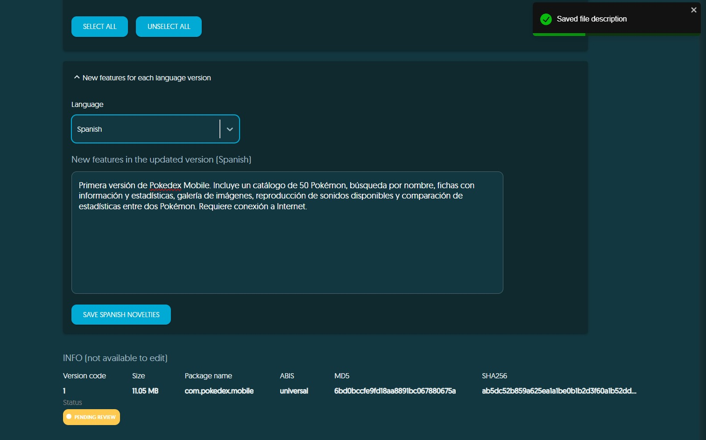
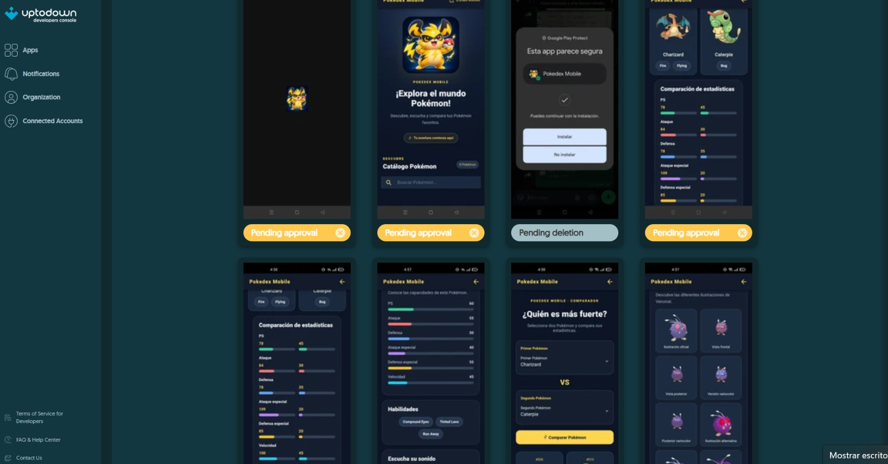
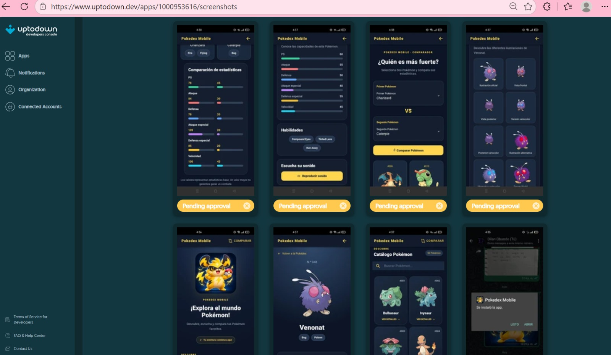
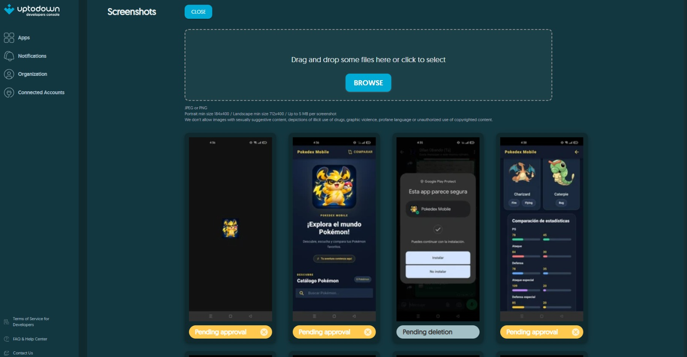

<div align="center">

# Pokedex Mobile

**Explora Pokémon. Consulta sus características. Compara sus estadísticas.**

<p>
  <a href="https://github.com/Dilanbkr7/pokeapp/tree/release/pokedex-mobile">
    
  </a>
  
  
  
  
  
</p>

**Aplicación móvil para Android · Versión 1.0.0**

[Repositorio](https://github.com/Dilanbkr7/pokeapp) · [Rama de entrega](https://github.com/Dilanbkr7/pokeapp/tree/release/pokedex-mobile)

</div>

---

## Descripción

**Pokedex Mobile** es una aplicación para Android que permite explorar un catálogo inicial de 50 Pokémon, consultar sus fichas individuales y comparar sus estadísticas principales desde una interfaz móvil en español.

La aplicación obtiene información mediante la API pública de **PokéAPI** y presenta los datos en módulos organizados para facilitar la consulta: catálogo, búsqueda, detalles, estadísticas, galería de imágenes, reproducción de sonidos disponibles y comparación entre dos Pokémon.

Se requiere conexión a Internet para consultar los datos y cargar los recursos remotos.

## Funcionalidades

| Módulo | Descripción |
|---|---|
| **Catálogo** | Presenta los primeros 50 Pokémon disponibles en el catálogo de la aplicación. |
| **Búsqueda** | Permite localizar registros por nombre. |
| **Ficha individual** | Muestra nombre, número, tipos, altura, peso, experiencia base y habilidades. |
| **Estadísticas** | Visualiza PS, ataque, defensa, ataque especial, defensa especial y velocidad mediante indicadores gráficos. |
| **Galería** | Permite consultar las imágenes disponibles de cada Pokémon. |
| **Sonidos** | Reproduce el audio disponible para el registro seleccionado. |
| **Comparador** | Permite seleccionar dos Pokémon y contrastar sus seis estadísticas base. |
| **Validaciones** | Controla la selección de registros y los estados de carga y consulta. |

## Galería de la aplicación

Las siguientes imágenes corresponden a capturas de la aplicación Android y se encuentran dentro del repositorio en `docs/capturas/release-1.0.0/`.

<table>
  <tr>
    <td align="center" width="50%">
      <br>
      <strong>01 · Inicio</strong><br>
      <sub>Identidad visual y acceso a la aplicación.</sub>
    </td>
    <td align="center" width="50%">
      <br>
      <strong>02 · Catálogo</strong><br>
      <sub>Listado y búsqueda por nombre.</sub>
    </td>
  </tr>
  <tr>
    <td align="center">
      <br>
      <strong>03 · Detalles</strong><br>
      <sub>Información general del Pokémon seleccionado.</sub>
    </td>
    <td align="center">
      <br>
      <strong>04 · Estadísticas y sonido</strong><br>
      <sub>Indicadores de capacidades, habilidades y audio.</sub>
    </td>
  </tr>
  <tr>
    <td align="center">
      <br>
      <strong>05 · Galería</strong><br>
      <sub>Recursos visuales disponibles.</sub>
    </td>
    <td align="center">
      <br>
      <strong>06 · Selección del comparador</strong><br>
      <sub>Elección de los dos registros que se compararán.</sub>
    </td>
  </tr>
  <tr>
    <td align="center">
      <br>
      <strong>07 · Resultados</strong><br>
      <sub>Presentación conjunta de los Pokémon seleccionados.</sub>
    </td>
    <td align="center">
      <br>
      <strong>08 · Comparación de estadísticas</strong><br>
      <sub>Contraste de los seis atributos principales.</sub>
    </td>
  </tr>
</table>

## Tecnologías

| Tecnología | Versión / configuración | Uso |
|---|---:|---|
| Angular | 18 | Componentes, navegación y lógica de interfaz. |
| Ionic | 8 | Componentes y estructura visual móvil. |
| TypeScript | 5.4.x | Desarrollo tipado. |
| Capacitor | 6 | Integración y empaquetado para Android. |
| RxJS | 7.8.x | Gestión de operaciones asíncronas. |
| PokéAPI | REST API v2 | Fuente de datos y recursos Pokémon. |
| Java JDK | 17 | Entorno de compilación Android. |
| Android Gradle Plugin | 8.2.1 | Configuración de compilación Android. |
| Gradle Wrapper | 8.2.1 | Automatización de tareas Android. |

## Configuración de la aplicación Android

| Propiedad | Valor |
|---|---|
| Nombre | `Pokedex Mobile` |
| Identificador de paquete | `com.pokedex.mobile` |
| Versión | `1.0.0` |
| Código de versión | `1` |
| SDK mínimo | `22` — Android 5.1 |
| SDK objetivo | `34` — Android 14 |
| Arquitectura del archivo cargado | `universal` |

## Requisitos de desarrollo

- Git.
- Node.js compatible con Angular 18.
- npm.
- Java JDK 17.
- Android Studio.
- Android SDK y herramientas de compilación correspondientes al proyecto.

## Instalación y ejecución

Clona la rama de entrega:

```bash
git clone --branch release/pokedex-mobile --single-branch https://github.com/Dilanbkr7/pokeapp.git
cd pokeapp
npm ci
```

Inicia la aplicación en el entorno de desarrollo:

```bash
npm start
```

Para generar la compilación web:

```bash
npm run build
```

## Preparación del proyecto Android

Desde la raíz del repositorio:

```bash
npm ci
npm run build
npx cap sync android
npx cap open android
```

En Android Studio:

1. Espera a que finalice la sincronización de Gradle.
2. Verifica que Gradle utilice JDK 17.
3. Selecciona un emulador o dispositivo Android conectado.
4. Ejecuta la configuración `app` para instalar y probar la aplicación.

Después de modificar el código web, ejecuta nuevamente `npm run build` y `npx cap sync android` antes de generar o probar la aplicación Android.

## Generación y verificación del APK

Para generar el APK de distribución desde Android Studio:

1. Abre el proyecto mediante `npx cap open android`.
2. Selecciona **Build → Generate Signed Bundle / APK**.
3. Selecciona **APK**.
4. Elige el módulo `app`.
5. Selecciona la configuración `release`.
6. Firma el archivo con el keystore de distribución correspondiente.

La verificación de la firma puede realizarse con `apksigner`:

```powershell
apksigner verify --verbose --print-certs .\app-release.apk
```

La alineación del archivo puede comprobarse con `zipalign`:

```powershell
zipalign -c -v 4 .\app-release.apk
```

**Protección de la firma:** el keystore, las contraseñas y los archivos de configuración privados de firma deben permanecer fuera del repositorio. Para futuras actualizaciones de la aplicación se debe conservar el certificado de firma utilizado en la versión publicada.

## Validaciones realizadas

Durante la preparación de la versión 1.0.0 se registraron las siguientes comprobaciones:

| Comprobación | Resultado |
|---|---|
| Compilación web con Angular | Correcta (`npm run build`). |
| Sincronización de Capacitor con Android | Correcta (`npx cap sync android`). |
| Compilación Android de desarrollo | `BUILD SUCCESSFUL`. |
| Pruebas funcionales manuales | 8 de 8 comprobaciones reportadas como superadas. |
| Revisión de cambios Git | `git diff --check` ejecutado. |
| Repositorio | Cambios documentados en la rama `release/pokedex-mobile`. |

Las comprobaciones funcionales manuales abarcaron instalación y apertura, catálogo, búsqueda, ficha de detalles, galería, comparación, reapertura de la aplicación y reproducción de audio disponible.

## Distribución en Uptodown

La aplicación fue registrada en **Uptodown Developers Console** y el archivo Android de la versión 1.0.0 fue cargado para revisión.

### Datos del envío

| Campo | Información |
|---|---|
| Aplicación | Pokedex Mobile |
| Versión | `1.0.0` |
| Version Code | `1` |
| Package name | `com.pokedex.mobile` |
| Tamaño del archivo cargado | `11.05 MB` |
| ABI | `universal` |
| Modelo de distribución | Free |
| Compras integradas | No |
| Suscripciones | No |
| Anuncios | No |
| Tipo de licencia configurado en la consola | Proprietary |
| Fecha del envío | 16 de noviembre de 2026 |
| Estado del envío | **Enviado correctamente; pendiente de revisión editorial** |

<blockquote>
<strong>Estado de publicación:</strong> Uptodown confirmó que la aplicación fue enviada correctamente a sus editores. La versión 1.0.0 figura pendiente de revisión. Este estado confirma el envío, pero no equivale a aprobación editorial ni a publicación pública.
</blockquote>

### Evidencias de Uptodown Developers Console

Las siguientes capturas documentan el proceso de configuración y envío de la aplicación. Se conservan como evidencia de la versión remitida a revisión.

#### Evidencias visuales de Uptodown`r`n`r`n<table>
    <tr>
      <td align="center" width="50%">
        <br>
        <strong>01 · Envío confirmado</strong><br>
        <sub>La consola confirma que la aplicación fue enviada correctamente.</sub>
      </td>
      <td align="center" width="50%">
        <br>
        <strong>02 · Confirmación de revisión</strong><br>
        <sub>Ventana de confirmación antes de remitir la aplicación a los editores.</sub>
      </td>
    </tr>
    <tr>
      <td align="center">
        <br>
        <strong>03 · Archivo 1.0.0</strong><br>
        <sub>Datos del paquete y estado pendiente de revisión.</sub>
      </td>
      <td align="center">
        <br>
        <strong>04 · Idioma y novedades</strong><br>
        <sub>Configuración en español y texto de novedades de la versión.</sub>
      </td>
    </tr>
    <tr>
      <td align="center">
        <br>
        <strong>05 · Estado de capturas</strong><br>
        <sub>Vista de gestión de las imágenes de la ficha.</sub>
      </td>
      <td align="center">
        <br>
        <strong>06 · Imágenes destacadas</strong><br>
        <sub>Recursos gráficos cargados para la presentación de la aplicación.</sub>
      </td>
    </tr>
    <tr>
      <td align="center">
        <br>
        <strong>07 · Galería de capturas</strong><br>
        <sub>Vista de las imágenes de la aplicación en la consola.</sub>
      </td>
      <td align="center">
        <br>
        <strong>08 · Carga de capturas</strong><br>
        <sub>Interfaz utilizada para incorporar las imágenes de la ficha.</sub>
      </td>
    </tr>
  </table>


La revisión del APK y la aprobación de los recursos gráficos son estados gestionados por Uptodown. La disponibilidad pública dependerá de la resolución editorial de la plataforma.

## Fuente de datos

La aplicación utiliza [PokéAPI](https://pokeapi.co/), una API REST pública.

| Recurso | Endpoint |
|---|---|
| Catálogo inicial | `https://pokeapi.co/api/v2/pokemon?limit=50&offset=0` |
| Ficha de un Pokémon | `https://pokeapi.co/api/v2/pokemon/{nombre_o_id}` |

La disponibilidad de imágenes alternativas y sonidos depende de los recursos proporcionados por la API y sus enlaces asociados.

## Estructura del repositorio

```text
pokeapp/
├── android/                         # Proyecto nativo Android con Capacitor
├── docs/
│   └── capturas/
│       ├── release-1.0.0/            # Capturas de la aplicación
│       └── uptodown/                 # Evidencias de envío y revisión
├── src/
│   ├── app/
│   │   ├── app.component.ts          # Componente raíz
│   │   ├── app-routing.module.ts     # Configuración de rutas
│   │   ├── pages/                    # Pantallas de la aplicación
│   │   └── services/                 # Servicios y consultas de datos
│   ├── assets/                       # Recursos estáticos
│   ├── environments/                 # Configuración de entornos
│   ├── theme/                        # Variables y estilos
│   └── main.ts                       # Inicio de Angular
├── capacitor.config.ts               # Configuración de Capacitor
├── ionic.config.json                 # Configuración de Ionic
├── angular.json                      # Configuración de Angular
├── package.json                      # Dependencias y scripts
└── README.md                         # Documentación del proyecto
```

## Propiedad intelectual

Pokémon y los nombres, personajes, marcas, diseños, ilustraciones, sprites y sonidos asociados pertenecen a sus respectivos titulares. Pokedex Mobile es un proyecto independiente y no está afiliado, patrocinado ni respaldado por Nintendo, The Pokémon Company, Game Freak o Creatures Inc.

PokéAPI se utiliza como fuente técnica de datos. Su disponibilidad no implica autorización para redistribuir marcas o recursos protegidos. La distribución de la aplicación y de sus recursos debe respetar los derechos de sus titulares y las condiciones aplicables.

## Autoría y repositorio

**Dilan Obando**

- GitHub: [@Dilanbkr7](https://github.com/Dilanbkr7)
- Repositorio: [Dilanbkr7/pokeapp](https://github.com/Dilanbkr7/pokeapp)
- Rama documentada: [`release/pokedex-mobile`](https://github.com/Dilanbkr7/pokeapp/tree/release/pokedex-mobile)

---

<div align="center">

**Pokedex Mobile · Android · Versión 1.0.0**

<sub>Documentación técnica y evidencias de distribución.</sub>

</div>
