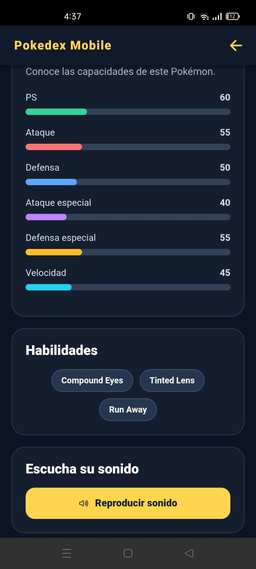
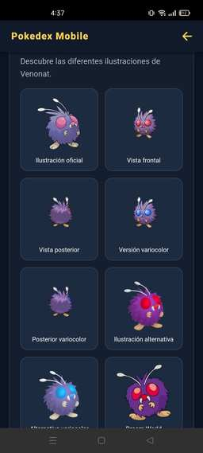
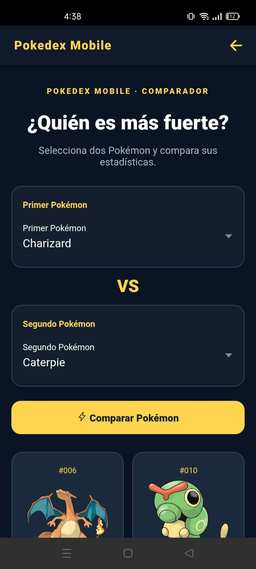

<div align="center">
  
  <h1>Pokedex Mobile</h1>
  <p><strong>Explora, consulta y compara Pokémon desde Android.</strong></p>
  <p>
    <a href="https://github.com/Dilanbkr7/pokeapp/tree/release/pokedex-mobile"></a>
    
    
    
    
  </p>
  <p><em>Proyecto académico independiente desarrollado con Ionic, Angular y Capacitor.</em></p>
</div>

> **Aviso de propiedad intelectual:** este proyecto es una implementación educativa e independiente. Pokémon, sus nombres, personajes, diseños, marcas, ilustraciones, sprites y sonidos pertenecen a sus respectivos titulares. El proyecto no está afiliado, patrocinado ni respaldado por Nintendo, The Pokémon Company, Game Freak o Creatures Inc. La disponibilidad pública de este repositorio no concede derechos sobre esos recursos; cualquier distribución pública de la aplicación debe respetar las autorizaciones y condiciones aplicables.

---

## Índice

- [Descripción](#descripción)
- [Funciones](#funciones)
- [Galería de la aplicación](#galería-de-la-aplicación)
- [Tecnologías](#tecnologías)
- [Arquitectura](#arquitectura)
- [Requisitos](#requisitos)
- [Instalación y ejecución](#instalación-y-ejecución)
- [Compilación para Android](#compilación-para-android)
- [Generación y verificación del APK firmado](#generación-y-verificación-del-apk-firmado)
- [Configuración técnica Android](#configuración-técnica-android)
- [Pruebas y comprobaciones](#pruebas-y-comprobaciones)
- [Distribución en Uptodown](#distribución-en-uptodown)
- [Estructura del repositorio](#estructura-del-repositorio)
- [API y recursos externos](#api-y-recursos-externos)
- [Seguridad y propiedad intelectual](#seguridad-y-propiedad-intelectual)
- [Autoría](#autoría)

## Descripción

**Pokedex Mobile** es una aplicación móvil construida con **Ionic + Angular** y empaquetada para Android mediante **Capacitor**. Consume la API pública de PokéAPI para presentar un catálogo inicial de 50 registros, permitir búsquedas por nombre, consultar fichas individuales y comparar las estadísticas base de dos Pokémon.

La interfaz utiliza un tema oscuro, tarjetas adaptables, indicadores visuales para las estadísticas y vistas específicas para catálogo, detalle, galería y comparación. La aplicación requiere conexión a Internet para consultar la API y cargar los recursos remotos.

## Funciones

| Módulo | Funcionalidad |
|---|---|
| **Catálogo** | Carga los primeros 50 registros de PokéAPI y los presenta en una cuadrícula. |
| **Búsqueda** | Filtra localmente por coincidencia parcial del nombre, sin distinguir mayúsculas y minúsculas. |
| **Ficha de detalle** | Muestra número, nombre, tipos, altura, peso, experiencia base, habilidades y estadísticas. |
| **Estadísticas** | Presenta PS, ataque, defensa, ataque especial, defensa especial y velocidad con barras visuales. |
| **Audio** | Reproduce el sonido disponible (`cries.latest` o, como alternativa, `cries.legacy`) y permite detenerlo. |
| **Galería** | Reúne sprites e ilustraciones disponibles; evita URLs duplicadas y oculta imágenes que no cargan. |
| **Comparador** | Permite seleccionar dos registros distintos y comparar sus seis estadísticas mediante consultas paralelas con RxJS `forkJoin`. |
| **Estados de interfaz** | Incluye estados de carga, mensajes de error y validaciones para búsquedas y comparaciones. |

La escala de las barras de estadísticas está limitada visualmente a 200 puntos. Un valor superior en una estadística no implica por sí solo que un Pokémon gane un combate.

## Galería de la aplicación

Capturas reales de la versión Android incluidas en el paquete de imágenes preparado para la ficha de Uptodown. Se incorporan aquí como documentación visual del funcionamiento de la aplicación.

<table>
  <tr>
    <td align="center" width="50%">
      <br>
      <strong>01 · Inicio</strong><br><sub>Identidad visual y acceso al catálogo.</sub>
    </td>
    <td align="center" width="50%">
      <br>
      <strong>02 · Catálogo</strong><br><sub>Listado inicial y búsqueda por nombre.</sub>
    </td>
  </tr>
  <tr>
    <td align="center">
      <br>
      <strong>03 · Detalles</strong><br><sub>Ficha individual y datos generales.</sub>
    </td>
    <td align="center">
      <br>
      <strong>04 · Estadísticas y sonido</strong><br><sub>Capacidades, habilidades y audio disponible.</sub>
    </td>
  </tr>
  <tr>
    <td align="center">
      <br>
      <strong>05 · Galería</strong><br><sub>Vistas e ilustraciones disponibles.</sub>
    </td>
    <td align="center">
      <br>
      <strong>06 · Comparador</strong><br><sub>Selección de dos registros distintos.</sub>
    </td>
  </tr>
  <tr>
    <td align="center">
      <br>
      <strong>07 · Resultados</strong><br><sub>Resumen visual de ambos Pokémon.</sub>
    </td>
    <td align="center">
      <br>
      <strong>08 · Comparación de estadísticas</strong><br><sub>Valores y barras comparativas.</sub>
    </td>
  </tr>
</table>

## Tecnologías

Versiones obtenidas de la configuración del proyecto (`package.json`, Gradle y archivos de Android):

| Tecnología | Versión / configuración | Responsabilidad |
|---|---:|---|
| Angular | 18.x | Componentes, ciclo de vida, navegación y servicios. |
| Ionic Angular | 8.x | Componentes visuales y experiencia móvil. |
| TypeScript | 5.4.x | Tipado y lógica de la aplicación. |
| Capacitor | 6.1.x | Integración entre la aplicación web y Android nativo. |
| RxJS | 7.8.x | Flujos asíncronos y consultas paralelas. |
| Ionicons | 7.x | Iconografía de la interfaz. |
| PokéAPI | REST API v2 | Datos y referencias a recursos. |
| Android Gradle Plugin | 8.2.1 | Compilación del proyecto Android. |
| Gradle Wrapper | 8.2.1 | Automatización de la compilación Android. |

## Arquitectura

El proyecto utiliza **componentes standalone** de Angular:

- `src/main.ts` inicia la aplicación con `bootstrapApplication`.
- `src/app/app.component.ts` declara el componente raíz con `standalone: true`.
- `src/app/pages/pokemon-list/pokemon-list.page.ts` contiene la pantalla principal como componente standalone e importa `CommonModule`, `FormsModule` e `IonicModule`.
- `src/app/app-routing.module.ts` configura la ruta `/pokemon-list` mediante carga diferida con `loadComponent`.
- `src/app/services/pokemon.service.ts` centraliza las solicitudes HTTP a PokéAPI.

El servicio expone operaciones para recuperar el listado y consultar detalles por nombre o identificador. La pantalla consume esos observables y gestiona los estados de carga, error, audio, galería y comparación.

## Requisitos

- Git.
- Node.js compatible con Angular 18 (se recomienda Node.js 20 LTS).
- npm.
- Conexión a Internet.
- Para Android: Android Studio, JDK 17 y Android SDK Platform 34 con sus Build-Tools y Platform-Tools.

## Instalación y ejecución

Clona directamente la rama de entrega:

```bash
git clone --branch release/pokedex-mobile --single-branch https://github.com/Dilanbkr7/pokeapp.git
cd pokeapp
npm ci
```

Inicia el servidor de desarrollo:

```bash
npm start
```

Abre [http://localhost:4200](http://localhost:4200). La ruta raíz redirige a `/pokemon-list`.

Para permitir pruebas desde otro dispositivo conectado a la misma red local:

```bash
npm start -- --host 0.0.0.0
```

Después abre `http://IP_LOCAL_DEL_EQUIPO:4200` desde el navegador del dispositivo. La conexión depende de la configuración de red y del firewall.

### Comandos disponibles

| Comando | Descripción |
|---|---|
| `npm start` | Inicia el servidor Angular/Ionic. |
| `npm run build` | Genera la compilación web de producción en `www/`. |
| `npm run watch` | Compila en modo desarrollo y observa cambios. |
| `npm test` | Ejecuta las pruebas configuradas con Jasmine y Karma. |
| `npm run lint` | Ejecuta el análisis estático configurado con ESLint. |

## Compilación para Android

La plataforma Android ya está incluida en `android/`.

Desde la raíz del repositorio:

```bash
npm ci
npm run build
npx cap sync android
npx cap open android
```

En Android Studio:

1. Espera a que finalice la sincronización de Gradle.
2. Comprueba que **Gradle JDK** apunte a JDK 17.
3. Selecciona un emulador o dispositivo Android con depuración USB habilitada.
4. Ejecuta la configuración `app` para instalar la compilación de desarrollo.

Después de modificar el código web, vuelve a ejecutar `npm run build` y `npx cap sync android` antes de probar la aplicación nativa.

## Generación y verificación del APK firmado

Para generar una versión de distribución desde Android Studio:

1. Abre el proyecto Android con `npx cap open android`.
2. Selecciona **Build → Generate Signed Bundle / APK**.
3. Elige **APK** y el módulo `app`.
4. Crea un keystore para la primera versión o selecciona el keystore original para una actualización.
5. Selecciona la variante `release` y completa el asistente.
6. Conserva el keystore y sus contraseñas en un lugar privado y seguro, fuera del repositorio.

Verifica el APK resultante desde PowerShell, ajustando la ruta al archivo y al Android SDK instalado:

```powershell
$apk = ".\app-release.apk"
& "$env:ANDROID_HOME\build-tools\34.0.0\apksigner.bat" verify --verbose --print-certs $apk
Get-FileHash -Algorithm SHA256 -LiteralPath $apk
```

Para instalarlo en un dispositivo conectado:

```powershell
& "$env:ANDROID_HOME\platform-tools\adb.exe" devices -l
& "$env:ANDROID_HOME\platform-tools\adb.exe" install -r $apk
```

**Seguridad:** no subas al repositorio el archivo `.jks`/`.keystore`, contraseñas, `key.properties` ni credenciales de firma. Para futuras actualizaciones debe conservarse el mismo certificado de firma.

## Configuración técnica Android

| Propiedad | Valor de la rama `release/pokedex-mobile` |
|---|---|
| `applicationId` / `appId` | `com.pokedex.mobile` |
| Nombre de aplicación | `Pokedex Mobile` |
| `versionName` | `1.0.0` |
| `versionCode` | `1` |
| `minSdkVersion` | 22 (Android 5.1) |
| `compileSdkVersion` | 34 |
| `targetSdkVersion` | 34 |
| Android Gradle Plugin | 8.2.1 |
| Gradle Wrapper | 8.2.1 |

## Pruebas y comprobaciones

Las siguientes comprobaciones corresponden a los registros compartidos durante el desarrollo. Las pruebas manuales no deben confundirse con una ejecución automatizada de CI.

| Comprobación | Evidencia / resultado |
|---|---|
| Pruebas funcionales en Android | El desarrollador reportó **8 de 8 comprobaciones manuales superadas**. |
| Compilación Android de desarrollo | Gradle informó `BUILD SUCCESSFUL` en 47 segundos (142 tareas accionables; 38 ejecutadas y 104 actualizadas). |
| Revisión de whitespace | `git diff --check` no reportó errores de whitespace; mostró avisos de conversión LF/CRLF de Windows. |
| Rama Git | `release/pokedex-mobile`. |
| Último commit de código comprobado | `a814fda` — `Corregir MainActivity y actualizar README de release`. |
| Estado del árbol de trabajo | El desarrollador reportó `git status` limpio después del push. |

Las ocho comprobaciones funcionales reportadas abarcan inicio, búsqueda, detalles, sonido, galería, comparación, validación de selección y reapertura de la aplicación.

## Distribución en Uptodown

La ficha de **Pokedex Mobile** fue preparada en Uptodown Developers Console. Los datos observados para el archivo cargado son:

| Dato | Valor visible en la consola |
|---|---|
| Versión | `1.0.0` |
| Version Code | `1` |
| Package name | `com.pokedex.mobile` |
| Tamaño del archivo | `11.05 MB` |
| ABI | `universal` |
| Modelo de distribución | Free |
| Compras / suscripciones / anuncios | No / No / No |
| Tipo de licencia configurado | Proprietary |

**Estado documentado al 16 de noviembre de 2026:** la ficha de la aplicación todavía aparecía como **DRAFT**. En la pestaña Files, la versión `1.0.0` aparecía con estado **Pending review** a nivel del archivo. La configuración de licencia se guardó y se confirmó nuevamente después de recargar la consola. No se había confirmado el envío final de la ficha mediante **Submit for Review**, ni existía todavía una página pública aprobada. Por tanto, este repositorio no afirma que la aplicación esté publicada.

Uptodown es el canal elegido para preparar la distribución de esta versión APK; no se requiere un AAB para el archivo APK cargado en esa plataforma. La aprobación editorial y los derechos sobre los recursos de terceros siguen siendo condiciones independientes.

## Estructura del repositorio

```text
pokeapp/
├── android/                         # Proyecto nativo Android / Capacitor
├── docs/
│   └── capturas/                   # Evidencia visual del proyecto
│       ├── nivel-*.jpeg             # Capturas de iteraciones anteriores
│       └── release-1.0.0/           # Ocho capturas Android de esta versión
├── src/
│   ├── app/
│   │   ├── app.component.ts         # Componente raíz standalone
│   │   ├── app-routing.module.ts    # Rutas de la aplicación
│   │   ├── pages/pokemon-list/      # Catálogo, detalles y comparador
│   │   └── services/                # Servicio de PokéAPI
│   ├── assets/                      # Recursos estáticos e iconografía
│   ├── environments/                # Configuración de entorno
│   ├── theme/                       # Variables de estilo
│   ├── global.scss                  # Estilos globales
│   └── main.ts                      # Bootstrap standalone
├── capacitor.config.ts              # Configuración de Capacitor
├── ionic.config.json                # Configuración Ionic
├── angular.json                     # Configuración Angular
├── package.json                     # Dependencias y scripts
└── README.md                        # Documentación del proyecto
```

## API y recursos externos

La aplicación utiliza la API REST pública de [PokéAPI](https://pokeapi.co/). No configura una clave privada para las consultas implementadas.

| Operación | Endpoint | Uso |
|---|---|---|
| Listado inicial | `GET https://pokeapi.co/api/v2/pokemon?limit=50&offset=0` | Recuperar los primeros 50 nombres y URLs. |
| Detalles | `GET https://pokeapi.co/api/v2/pokemon/{nombre_o_id}` | Consultar tipos, medidas, experiencia, estadísticas, habilidades, sprites y sonidos. |

Las imágenes se solicitan desde los recursos enlazados por PokéAPI y su repositorio de sprites. La disponibilidad de sprites alternativos y sonidos depende de cada registro y de los servicios externos.

## Seguridad y propiedad intelectual

- La aplicación necesita Internet para consultar PokéAPI y descargar recursos remotos.
- No se deben incluir contraseñas, claves privadas ni archivos de firma en Git.
- El repositorio no incorpora un archivo `LICENSE`; que sea público no significa que el código esté automáticamente licenciado bajo MIT, Apache u otra licencia abierta.
- Los recursos, marcas y personajes de Pokémon son propiedad de sus respectivos titulares. La mención de PokéAPI como fuente técnica no equivale a una autorización para redistribuir activos protegidos.
- Antes de una distribución pública, se deben revisar las condiciones de uso de la API y obtener las autorizaciones necesarias para los recursos protegidos, o sustituirlos por contenido original con derechos claros.

## Autoría

**Dilan Obando** — desarrollo del proyecto académico de Aplicaciones Móviles.

- GitHub: [@Dilanbkr7](https://github.com/Dilanbkr7)
- Repositorio: [Dilanbkr7/pokeapp](https://github.com/Dilanbkr7/pokeapp)
- Rama documentada: [`release/pokedex-mobile`](https://github.com/Dilanbkr7/pokeapp/tree/release/pokedex-mobile)

---

<div align="center">
  <sub>Documentación de la versión 1.0.0 · Android · Ionic + Angular + Capacitor</sub>
</div>
