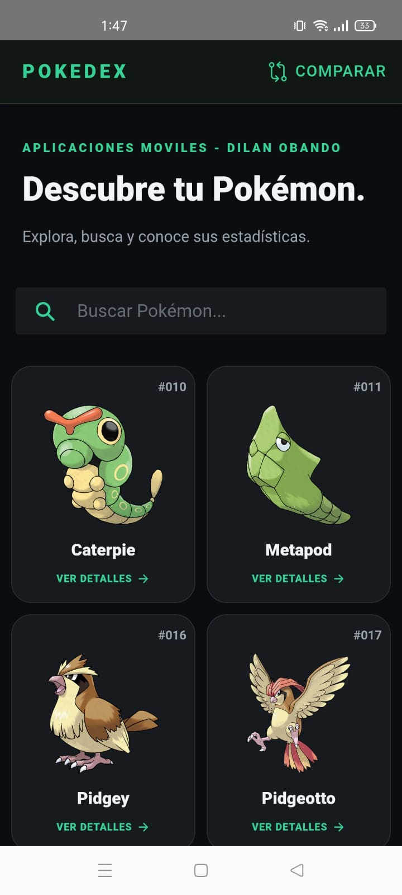
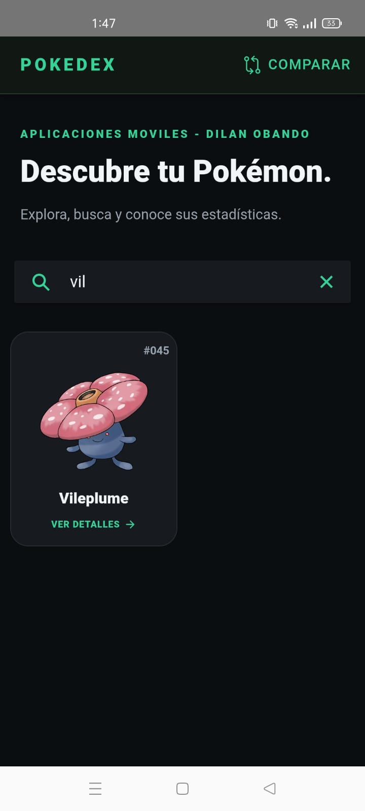
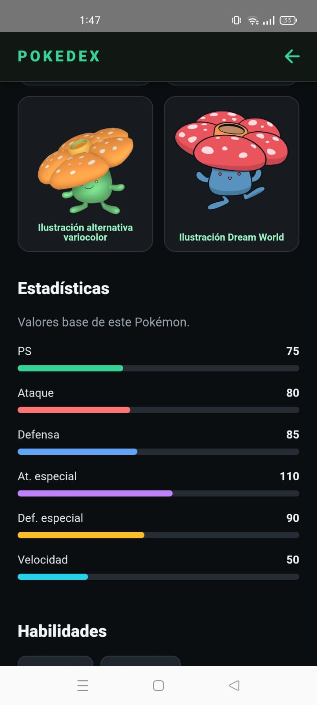
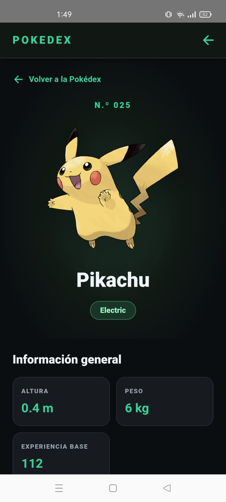
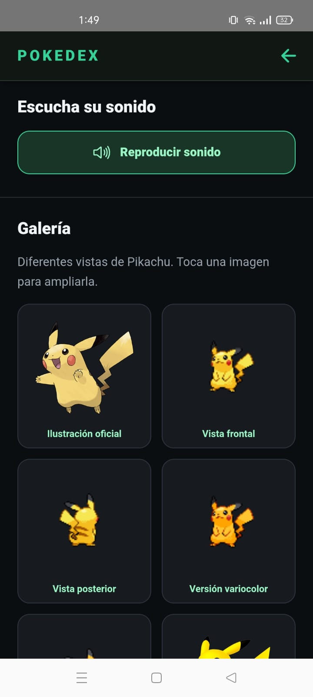
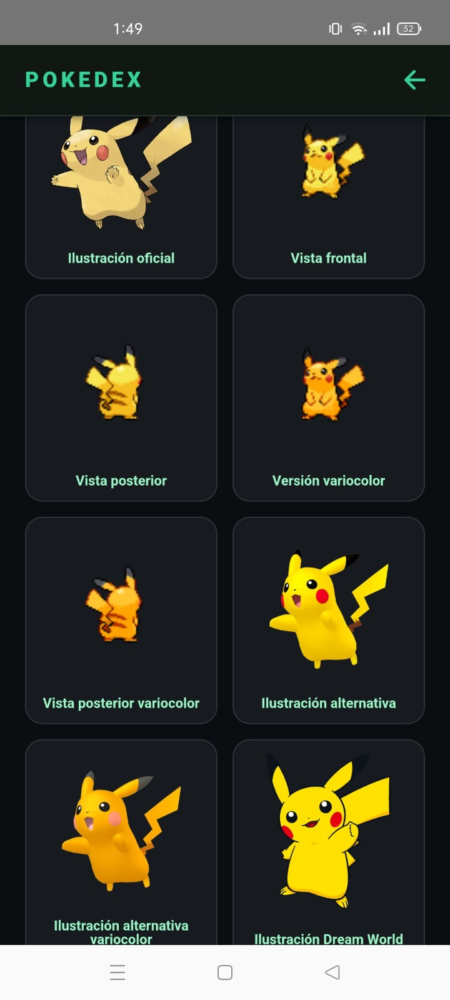
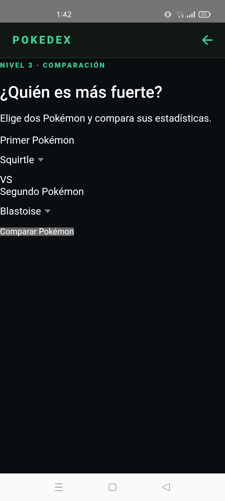
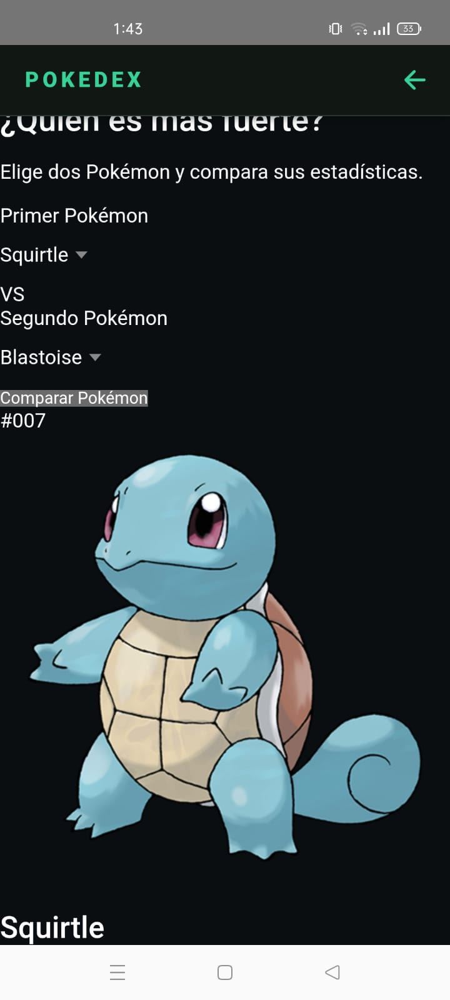
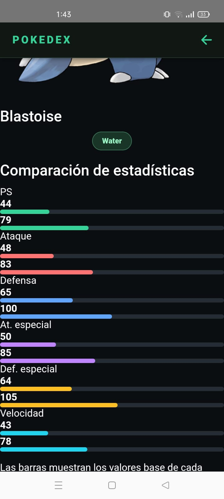

# PokéApp · Pokédex móvil

Aplicación desarrollada para la asignatura **Aplicaciones Móviles**, que permite explorar Pokémon, consultar sus características, reproducir sus sonidos y comparar sus estadísticas mediante el consumo de **PokéAPI**.

**Autor:** Dilan Obando  
**Repositorio:** [Dilanbkr7/pokeapp](https://github.com/Dilanbkr7/pokeapp)

## Capturas en celular

Evidencias proporcionadas de la aplicación en un dispositivo Android, organizadas según las tres etapas del trabajo.

### Nivel 1 · Catálogo, búsqueda y estadísticas

<table>
  <tr>
    <th>Catálogo principal</th>
    <th>Búsqueda de Vileplume</th>
    <th>Estadísticas y habilidades</th>
  </tr>
  <tr>
    <td></td>
    <td></td>
    <td></td>
  </tr>
</table>

### Nivel 2 · Ficha, sonido y galería

<table>
  <tr>
    <th>Ficha de Pikachu</th>
    <th>Control de sonido</th>
    <th>Galería de imágenes</th>
  </tr>
  <tr>
    <td></td>
    <td></td>
    <td></td>
  </tr>
</table>

### Nivel 3 · Comparación de Squirtle y Blastoise

<table>
  <tr>
    <th>Selección de Pokémon</th>
    <th>Resultado de la consulta</th>
    <th>Comparación de estadísticas</th>
  </tr>
  <tr>
    <td></td>
    <td></td>
    <td></td>
  </tr>
</table>

## Contenido

- [Capturas en celular](#capturas-en-celular)
- [Descripción](#descripción)
- [Funcionalidades por nivel](#funcionalidades-por-nivel)
- [Tecnologías](#tecnologías)
- [Instalación y ejecución](#instalación-y-ejecución)
- [Uso de la API](#uso-de-la-api)
- [Estructura del proyecto](#estructura-del-proyecto)
- [Estado y alcance](#estado-y-alcance)
- [Créditos](#créditos)

## Descripción

PokéApp presenta un catálogo de Pokémon mediante tarjetas con su número, nombre e ilustración oficial. Desde el buscador se puede filtrar el catálogo y acceder a una ficha con información general, recursos multimedia, estadísticas y habilidades.

La interfaz utiliza un tema oscuro con acentos verdes, una cuadrícula adaptable y barras de colores para facilitar la lectura de las estadísticas. El proyecto incluye una plataforma Android configurada con Capacitor.

## Funcionalidades por nivel

### Nivel 1 · Búsqueda y detalles

- Catálogo inicial de los primeros **50 Pokémon**.
- Búsqueda por coincidencias parciales del nombre, sin distinguir mayúsculas y minúsculas.
- Ficha con ilustración, número de Pokédex y tipos.
- Altura en metros, peso en kilogramos y experiencia base.
- Estadísticas base: PS, ataque, defensa, ataque especial, defensa especial y velocidad.
- Visualización de habilidades, estados de carga y mensajes de error.

### Nivel 2 · Sonido y galería

- Reproducción y detención del sonido del Pokémon a partir de `cries.latest`.
- Mensajes cuando el sonido no está disponible o no puede reproducirse.
- Galería con ilustración oficial, vistas frontal y posterior, versiones variocolor e ilustraciones alternativas, según los recursos disponibles.
- Más de cinco imágenes visibles en la evidencia de Pikachu.
- Ampliación de imágenes al tocarlas y eliminación de URLs duplicadas al construir la galería.

### Nivel 3 · Comparación

- Selección de dos Pokémon del catálogo.
- Consulta simultánea de sus fichas con `forkJoin` de RxJS.
- Visualización de sus ilustraciones, nombres, números y tipos.
- Comparación de las seis estadísticas base mediante valores numéricos y barras de colores.
- Validación para evitar seleccionar dos Pokémon iguales o dejar la selección incompleta.

Las barras utilizan una escala visual de 200 puntos, limitada al 100 %. Un valor base mayor no garantiza ganar un combate.

## Tecnologías

Versiones declaradas en el `package.json` del repositorio:

| Tecnología | Versión | Uso en el proyecto |
| --- | --- | --- |
| Ionic Angular | 8 | Componentes de interfaz y distribución adaptable |
| Angular | 18 | Componentes, formularios, navegación y peticiones HTTP |
| TypeScript | 5.4 | Lógica de la aplicación y definición de interfaces |
| Capacitor | 6 | Integración del proyecto web con Android |
| RxJS | 7.8 | Manejo de observables y consultas simultáneas |
| Ionicons | 7 | Iconografía de la interfaz |
| HTML y SCSS | — | Plantillas, tema oscuro y estilos |
| PokéAPI | API v2 | Datos y referencias a recursos de los Pokémon |

## Instalación y ejecución

### Requisitos

- Git.
- Node.js y npm compatibles con Angular 18.
- Conexión a Internet para consultar los datos y cargar imágenes y sonidos.
- Android Studio y el SDK de Android para ejecutar la versión nativa.

### Ejecutar en el navegador

```bash
git clone https://github.com/Dilanbkr7/pokeapp.git
cd pokeapp
npm ci
npm start
```

Abrir [http://localhost:4200](http://localhost:4200). La ruta inicial redirige a `/pokemon-list`.

### Probar desde el navegador del celular

Conectar el equipo y el celular a la misma red Wi-Fi y ejecutar:

```bash
npm start -- --host 0.0.0.0
```

En el celular, abrir `http://<IP_LOCAL_DEL_EQUIPO>:4200`, reemplazando el marcador por la dirección IP del equipo. Si la conexión no se establece, revisar que el firewall permita el acceso al servidor de desarrollo desde la red local.

### Ejecutar en Android

La carpeta `android/` ya está incluida en el repositorio:

```bash
npm run build
npx cap sync android
npx cap open android
```

En Android Studio, esperar la sincronización de Gradle, seleccionar un celular conectado con depuración USB habilitada y ejecutar la aplicación. Repetir la compilación y sincronización después de modificar el código web.

### Comandos disponibles

| Comando | Descripción |
| --- | --- |
| `npm start` | Inicia el servidor de desarrollo |
| `npm run build` | Genera la aplicación web en `www/` |
| `npm run watch` | Compila en modo desarrollo y observa cambios |
| `npm test` | Ejecuta las pruebas configuradas con Jasmine y Karma |
| `npm run lint` | Ejecuta el análisis estático con ESLint |

## Uso de la API

El servicio `PokemonService` centraliza las peticiones con `HttpClient` y devuelve observables.

| Consulta | Endpoint | Propósito |
| --- | --- | --- |
| Listado inicial | `GET https://pokeapi.co/api/v2/pokemon?limit=50&offset=0` | Obtener los nombres y URLs del catálogo |
| Detalles | `GET https://pokeapi.co/api/v2/pokemon/{nombre_o_id}` | Obtener tipos, medidas, estadísticas, habilidades, sprites y sonido |

El buscador filtra localmente los nombres del listado cargado. Al abrir una ficha se solicita su información completa y se construye la galería. En el comparador se consultan las dos fichas y se muestran sus valores base.

Las ilustraciones y los sprites se obtienen de los recursos de [PokeAPI/sprites](https://github.com/PokeAPI/sprites). La reproducción de audio utiliza la API de audio del navegador mediante `new Audio(...)`. No se requiere configurar una clave de API en el proyecto.

## Estructura del proyecto

```text
pokeapp/
├── android/                         # Proyecto nativo Android
├── src/
│   ├── app/
│   │   ├── app-routing.module.ts     # Ruta inicial y carga de la página
│   │   ├── home/                     # Página adicional incluida en el proyecto
│   │   ├── pages/pokemon-list/
│   │   │   ├── pokemon-list.page.ts   # Catálogo, fichas, multimedia y comparación
│   │   │   ├── pokemon-list.page.html # Plantilla de las vistas
│   │   │   └── pokemon-list.page.scss # Estilos de la página
│   │   └── services/
│   │       └── pokemon.service.ts     # Consultas a PokéAPI
│   ├── assets/                       # Recursos estáticos
│   ├── environments/                 # Configuración por entorno
│   ├── theme/                        # Variables de estilos
│   └── global.scss                   # Estilos globales
├── docs/capturas/                    # Evidencias de los tres niveles
├── angular.json                     # Configuración de Angular
├── capacitor.config.ts              # Configuración de Capacitor
└── package.json                     # Dependencias y comandos
```

## Estado y alcance

- El catálogo y los selectores trabajan con los primeros 50 Pokémon; no se implementa paginación en la interfaz actual.
- La cantidad de imágenes y la disponibilidad de sonido dependen de los recursos de cada Pokémon.
- El repositorio incluye configuración de pruebas automatizadas; esta documentación no afirma que dichas pruebas hayan sido ejecutadas o aprobadas.

## Créditos

Desarrollado por **[Dilan Obando](https://github.com/Dilanbkr7)** como trabajo en clase de **Aplicaciones Móviles**.

Datos proporcionados por [PokéAPI](https://pokeapi.co/) y recursos visuales de [PokeAPI/sprites](https://github.com/PokeAPI/sprites). Pokémon y sus personajes pertenecen a sus respectivos titulares. Proyecto con fines educativos.
